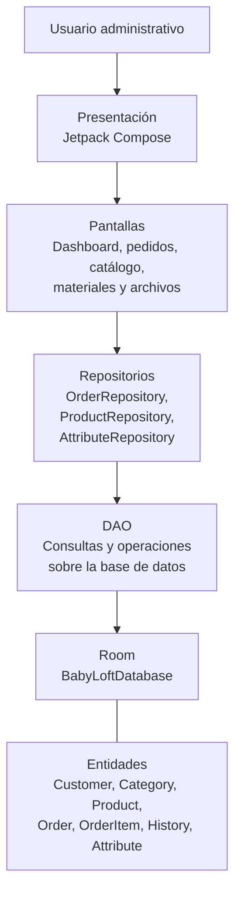
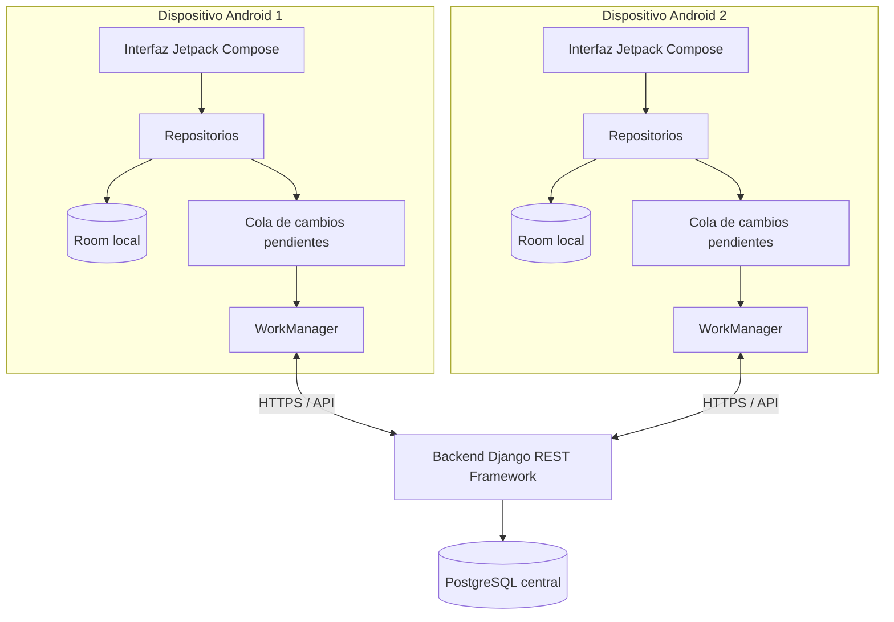

# 02. Arquitectura del sistema — Baby Loft Management

## 1. Introducción

Este documento describe la arquitectura de software de Baby Loft Management, una aplicación móvil para la gestión administrativa de pedidos, clientes, productos y materiales de Baby Loft.

El objetivo es documentar la organización técnica del proyecto, las responsabilidades de sus principales componentes, el flujo de información dentro de la aplicación y las decisiones necesarias para su evolución.

Se diferencian dos escenarios:

- **Arquitectura actual:** aplicación Android con interfaz desarrollada en Kotlin y Jetpack Compose, acceso a datos mediante repositorios y persistencia local utilizando Room.
- **Arquitectura objetivo:** aplicación Android con almacenamiento local y sincronización con un servidor central, que permita compartir información entre varios dispositivos.

La arquitectura objetivo representa una propuesta de evolución y no debe interpretarse como una funcionalidad disponible hasta que se implemente y se compruebe su funcionamiento.

## 2. Objetivos de la arquitectura

La arquitectura del sistema busca cumplir los siguientes objetivos:

- Separar las responsabilidades de la interfaz, la lógica de acceso a datos y el almacenamiento.
- Facilitar el mantenimiento y la modificación de los módulos existentes.
- Mantener organizada la información relacionada con los pedidos y los productos.
- Permitir que las pantallas consulten y modifiquen datos mediante componentes definidos.
- Reducir la duplicación de lógica entre las diferentes pantallas.
- Facilitar las pruebas y la identificación de errores.
- Conservar los datos localmente mediante Room.
- Permitir una futura integración con un servidor central.
- Preparar la aplicación para trabajar con varios dispositivos sin depender exclusivamente de una base de datos local.
- Mantener una evolución gradual que no obligue a reconstruir todo el proyecto desde cero.

## 3. Arquitectura actual

La versión actual está orientada a una aplicación Android con almacenamiento local. Su organización puede describirse mediante las siguientes capas lógicas:

1. Presentación.
2. Repositorios.
3. Acceso a datos mediante DAO.
4. Entidades.
5. Base de datos local.

Estas capas representan las responsabilidades principales de la aplicación. La existencia de una capa o archivo no garantiza que todas las operaciones estén completas; su comportamiento debe verificarse en el código y mediante pruebas.

### 3.1. Diagrama general de la arquitectura actual



El diagrama representa el flujo lógico general de las operaciones de la aplicación. Las entidades definen la estructura de los datos que Room almacena, mientras que los DAO proporcionan las operaciones de consulta y modificación de los registros.

## 4. Capa de presentación

### 4.1. Responsabilidad

La capa de presentación es la encargada de mostrar la información al usuario y permitir su interacción con el sistema.

En Baby Loft Management, esta capa utiliza Jetpack Compose para construir la interfaz de usuario mediante componentes declarativos de Kotlin.

Entre sus responsabilidades se encuentran:

- Mostrar listas de pedidos.
- Presentar los detalles de una orden.
- Capturar los datos ingresados al crear un pedido.
- Mostrar el catálogo de productos.
- Facilitar el acceso a los módulos de administración.
- Presentar los datos que el usuario necesita consultar.
- Permitir la interacción con los controles de la interfaz.

La presentación no debería encargarse directamente de administrar las conexiones con la base de datos ni de duplicar las reglas de negocio.

### 4.2. Pantallas principales

La estructura del proyecto incluye pantallas relacionadas con las siguientes funciones:

| Pantalla | Responsabilidad principal |
|---|---|
| `AdminDashboardScreen.kt` | Presentar el panel administrativo. |
| `OrderListScreen.kt` | Mostrar la lista de pedidos. |
| `OrderDetailScreen.kt` | Presentar los detalles de una orden. |
| `OrderCreateScreen.kt` | Permitir ingresar los datos necesarios para registrar un pedido. |
| `ProductCatalogScreen.kt` | Consultar el catálogo de productos. |
| `ArchivedOrdersScreen.kt` | Mostrar los pedidos disponibles en la sección de archivados. |
| `ManageMaterialsScreen.kt` | Consultar o administrar los materiales y atributos contemplados por el módulo. |

Estas pantallas representan los puntos principales de interacción del usuario con la aplicación. Las operaciones concretas disponibles en cada una deben comprobarse en la implementación correspondiente.

### 4.3. Principios para la capa de presentación

Se recomienda mantener las siguientes prácticas:

- Separar los componentes visuales de las operaciones de almacenamiento.
- Evitar consultas SQL o acceso directo a Room desde las pantallas.
- Mantener las validaciones necesarias para facilitar el ingreso correcto de datos.
- Evitar duplicar lógica de negocio entre diferentes pantallas.
- Representar claramente los estados de carga, ausencia de datos y error cuando corresponda.
- Mantener una navegación coherente entre los módulos.

Si en el futuro se incorpora una capa de estado de pantalla mediante ViewModel, esta debe coordinar la presentación con los repositorios sin trasladar la lógica de almacenamiento directamente a los componentes visuales.

## 5. Capa de repositorios

### 5.1. Responsabilidad

Los repositorios actúan como intermediarios entre la presentación y las fuentes de datos.

Su función es ofrecer operaciones organizadas para consultar, crear y modificar la información sin obligar a las pantallas a conocer los detalles internos de Room.

Esta separación permite que los cambios en la forma de almacenar los datos afecten menos a la interfaz.

### 5.2. Repositorios identificados

| Componente | Responsabilidad general |
|---|---|
| `OrderRepository.kt` | Gestionar operaciones relacionadas con pedidos y sus datos asociados. |
| `ProductRepository.kt` | Gestionar operaciones relacionadas con productos y categorías, de acuerdo con su implementación. |
| `AttributeRepository.kt` | Gestionar operaciones relacionadas con los atributos configurables. |

Las responsabilidades exactas de cada repositorio deben documentarse conforme a sus métodos actuales.

### 5.3. Ventajas de utilizar repositorios

El uso de repositorios permite:

- Centralizar operaciones relacionadas con los datos.
- Reducir el acoplamiento entre la interfaz y Room.
- Reutilizar operaciones desde distintas pantallas.
- Facilitar la incorporación de validaciones.
- Mejorar la organización de las consultas y modificaciones.
- Preparar la aplicación para integrar fuentes de datos adicionales.

### 5.4. Evolución futura

Cuando se incorpore el servidor central, los repositorios podrán ampliarse para coordinar el almacenamiento local y la comunicación con el servidor.

Sin embargo, esta evolución debe realizarse cuidadosamente. No es recomendable agregar llamadas de red directamente a las pantallas ni sustituir Room sin definir previamente las reglas de sincronización.

## 6. Capa de acceso a datos: DAO

### 6.1. Responsabilidad

Los DAO (Data Access Objects) definen las operaciones utilizadas para acceder a los registros de la base de datos.

En Room, estas operaciones suelen declararse mediante interfaces o clases abstractas y anotaciones como `@Dao`, `@Query`, `@Insert`, `@Update` y `@Delete`.

Sus responsabilidades pueden incluir:

- Consultar registros.
- Insertar nuevos datos.
- Actualizar información existente.
- Eliminar registros cuando corresponda.
- Consultar relaciones entre entidades.
- Ejecutar operaciones necesarias para los repositorios.

### 6.2. Relación con Room

Los DAO no representan bases de datos independientes. Son componentes que Room utiliza para generar la implementación del acceso a los datos.

El flujo general de una operación es:

1. La pantalla solicita una acción.
2. El repositorio recibe la solicitud.
3. El repositorio utiliza el DAO correspondiente.
4. Room ejecuta la operación sobre la base de datos local.
5. El resultado regresa al repositorio.
6. La presentación actualiza la información mostrada al usuario.

### 6.3. Consideraciones de integridad

Las operaciones que modifican varias tablas relacionadas deben mantener la consistencia de los datos.

Por ejemplo, la creación de una orden puede requerir guardar información del pedido y sus elementos asociados. Cuando estas operaciones deben completarse como una sola unidad lógica, se recomienda utilizar transacciones de base de datos.

La estrategia concreta depende de las operaciones que estén implementadas en los repositorios y DAO.

## 7. Capa de entidades

Las entidades representan las estructuras de datos que Room utiliza para almacenar la información.

Cada entidad normalmente corresponde a una tabla y define sus columnas, claves y relaciones según el modelo implementado.

### 7.1. Entidades principales

La base de datos actual contempla las siguientes entidades:

| Entidad | Propósito |
|---|---|
| `CustomerEntity` | Representar la información de los clientes. |
| `CategoryEntity` | Representar las categorías de productos. |
| `ProductEntity` | Representar los productos del catálogo. |
| `OrderEntity` | Representar los pedidos registrados. |
| `OrderItemEntity` | Representar los productos y cantidades asociados a una orden. |
| `OrderStatusHistoryEntity` | Representar los cambios de estado registrados para los pedidos. |
| `AttributeEntity` | Representar atributos configurables relacionados con características de los productos, como telas, colores o tallas, según el modelo implementado. |

Los nombres de las entidades y sus responsabilidades deben mantenerse alineados con los archivos Kotlin correspondientes.

### 7.2. Relaciones generales

Conceptualmente, el modelo de datos contempla relaciones como las siguientes:

- Un cliente puede estar asociado con varios pedidos.
- Un pedido puede contener varios elementos de pedido.
- Un elemento de pedido representa un producto solicitado y los datos asociados definidos por el modelo.
- Un pedido puede tener varios registros de historial de estados.
- Una categoría puede agrupar varios productos.
- Los atributos permiten representar características configurables utilizadas por los módulos que los consultan.

La cardinalidad exacta, las claves foráneas, las reglas de eliminación y las restricciones deben verificarse en las entidades reales antes de considerarse especificaciones definitivas.

## 8. Base de datos local: Room

### 8.1. Responsabilidad

Room es la biblioteca utilizada para trabajar con una base de datos SQLite de manera estructurada desde Kotlin.

Su función dentro del proyecto es almacenar la información local de la aplicación y proporcionar mecanismos para consultarla y modificarla.

El componente principal identificado es:

`data/local/BabyLoftDatabase.kt`

La configuración de Room define la base de datos y registra las entidades que participan en ella.

### 8.2. Beneficios del almacenamiento local

El almacenamiento local ofrece ventajas importantes:

- Permite conservar datos en el dispositivo.
- Evita depender de una conexión a internet para cada consulta local.
- Facilita las operaciones de lectura y escritura compatibles con el modelo actual.
- Proporciona una estructura persistente para pedidos, clientes y productos.
- Permite realizar pruebas sin necesitar un servidor remoto.

### 8.3. Limitaciones del almacenamiento local

Una base de datos Room instalada en un dispositivo no comparte automáticamente sus registros con otras instalaciones de la aplicación.

Por ejemplo, si dos teléfonos tienen la aplicación instalada, cada uno puede tener su propia base de datos local. Un pedido creado en uno no aparecerá automáticamente en el otro.

Además:

- Los datos locales pueden perderse si se eliminan los datos de la aplicación o se desinstala.
- No existe respaldo centralizado por el simple hecho de utilizar Room.
- Los identificadores autoincrementales locales no garantizan identificadores únicos entre dispositivos.
- La aplicación necesita una estrategia adicional para compartir datos y resolver conflictos.

Estas limitaciones deben tenerse presentes antes de utilizar la aplicación como único registro operativo del negocio.

## 9. Flujo general de información

El flujo habitual de una operación local puede describirse de la siguiente manera.

### 9.1. Consulta de información

1. El usuario abre una pantalla, por ejemplo, la lista de pedidos.
2. La pantalla solicita los datos mediante el componente que coordina la operación.
3. El repositorio ejecuta la consulta mediante el DAO.
4. Room recupera los registros almacenados.
5. El resultado se devuelve a la capa de presentación.
6. La pantalla muestra la información al usuario.

### 9.2. Creación de un pedido

1. El usuario accede a la pantalla de creación de pedidos.
2. Ingresa los datos solicitados.
3. La aplicación realiza las validaciones contempladas por el flujo.
4. El repositorio coordina las operaciones de almacenamiento.
5. Room guarda la información correspondiente.
6. La aplicación presenta el resultado y permite consultar el pedido registrado.

Las validaciones, los datos obligatorios y las operaciones concretas deben corresponder al código existente.

### 9.3. Actualización de un pedido

1. El usuario consulta una orden existente.
2. Selecciona una acción de modificación disponible.
3. La aplicación prepara los datos que deben actualizarse.
4. El repositorio ejecuta las operaciones correspondientes.
5. Room almacena los cambios.
6. La pantalla muestra el resultado actualizado.

Si la actualización implica registrar un cambio de estado, debe mantenerse la coherencia entre el estado actual de la orden y el historial correspondiente.

## 10. Arquitectura objetivo: aplicación con servidor central

### 10.1. Propósito

La evolución prevista consiste en permitir que Baby Loft Management pueda utilizarse desde varios dispositivos y que la información compartida esté disponible de manera centralizada.

Para ello se propone mantener Room en cada dispositivo Android e incorporar un backend que permita intercambiar información entre las aplicaciones y una base de datos central.

La propuesta tecnológica contempla:

- **Aplicación Android:** Kotlin y Jetpack Compose.
- **Base de datos local:** Room.
- **Mecanismo de tareas de sincronización:** WorkManager.
- **Backend:** Django REST Framework.
- **Base de datos central:** PostgreSQL.
- **Comunicación:** API HTTP protegida mediante HTTPS.
- **Acceso remoto:** mecanismo seguro de publicación del servicio, cuando sea necesario.

Esta arquitectura es una propuesta para la siguiente etapa del proyecto y no implica que todos estos componentes estén integrados actualmente.

### 10.2. Diagrama de arquitectura objetivo



El diagrama muestra una arquitectura propuesta en la que cada dispositivo conserva una copia local de los datos necesarios y se comunica con el backend para compartir información.

## 11. Funcionamiento previsto de la sincronización

### 11.1. Operación sin conexión

Cuando un dispositivo no tiene acceso al servidor, las operaciones compatibles deben poder guardarse localmente.

El dispositivo deberá registrar cuáles cambios están pendientes de enviar, sin asumir que ya se encuentran disponibles para los demás equipos.

### 11.2. Recuperación de conectividad

Cuando exista conexión y el servidor esté disponible, el mecanismo de sincronización deberá:

1. Identificar los cambios locales pendientes.
2. Enviar los cambios al backend.
3. Validar la información recibida.
4. Guardar los cambios aceptados en la base de datos central.
5. Recibir la confirmación del servidor.
6. Marcar como sincronizados únicamente los cambios confirmados.
7. Descargar o consultar los cambios remotos que deban reflejarse en el dispositivo.
8. Actualizar la base de datos local de manera consistente.

El comportamiento exacto dependerá del diseño de la API, la cola de sincronización y las reglas de conflicto que se implementen.

### 11.3. Uso simultáneo desde varios dispositivos

Si dos dispositivos modifican el mismo registro, el sistema necesitará una estrategia para decidir cómo conservar los cambios.

Algunas alternativas son:

- Utilizar una versión del registro para detectar modificaciones concurrentes.
- Registrar la fecha de modificación y el origen del cambio.
- Rechazar una actualización cuando el registro haya cambiado desde la última consulta.
- Solicitar que el usuario revise un conflicto cuando no sea seguro resolverlo automáticamente.

No se recomienda depender únicamente de la hora del dispositivo para decidir qué modificación debe prevalecer.

### 11.4. Identificadores únicos

La futura arquitectura debe permitir identificar cada registro de manera única, incluso cuando se cree sin conexión en distintos teléfonos.

Para ello puede utilizarse un identificador global, como un UUID, o una estrategia equivalente que garantice unicidad.

También deberá definirse por separado cómo se genera el número de pedido que ve el usuario, evitando duplicaciones entre dispositivos.

## 12. Responsabilidades del servidor central

El backend tendrá la responsabilidad de recibir y validar las solicitudes de las aplicaciones Android.

Entre sus funciones previstas se encuentran:

- Proporcionar endpoints para consultar y modificar clientes.
- Gestionar productos y categorías.
- Registrar y consultar pedidos.
- Administrar elementos de pedido.
- Registrar y consultar el historial de estados.
- Gestionar atributos y materiales.
- Validar los datos recibidos.
- Aplicar las reglas de integridad del sistema.
- Gestionar la autenticación y autorización.
- Facilitar los mecanismos de sincronización.
- Registrar errores relevantes para el mantenimiento.
- Permitir realizar copias de seguridad de la información central.

PostgreSQL será la base de datos central propuesta para almacenar los datos compartidos entre dispositivos.

La API debe actuar como intermediaria entre las aplicaciones y la base de datos. Los teléfonos no deben conectarse directamente a PostgreSQL ni recibir credenciales de acceso a la base de datos.

## 13. Seguridad y acceso remoto

La futura arquitectura debe considerar que los dispositivos podrían conectarse desde redes diferentes, incluidas redes móviles.

Por ello, la implementación deberá contemplar:

- Comunicación mediante HTTPS.
- Autenticación de los usuarios autorizados.
- Autorización para las operaciones que puede realizar cada usuario.
- Protección de las credenciales y los tokens.
- Validación de los datos recibidos por la API.
- Protección de la base de datos central.
- Registro de errores y eventos importantes.
- Copias de seguridad y procedimientos de recuperación.
- Configuración segura del acceso remoto al servidor.

Si el servidor se ejecuta en un computador portátil, su disponibilidad dependerá de que esté encendido, conectado a internet y ejecutando los servicios necesarios.

Un mecanismo de acceso remoto puede facilitar la comunicación con el servidor, pero no reemplaza la autenticación, la protección de la API ni las copias de seguridad.

## 14. Organización propuesta del código

La estructura actual debe conservarse mientras se realizan las mejoras. La incorporación de nuevos componentes debe seguir la organización existente y evitar duplicar responsabilidades.

Una posible evolución de la estructura es:

```text
app/src/main/java/com/babyloft/management/
├── data/
│   ├── local/
│   │   ├── BabyLoftDatabase.kt
│   │   ├── dao/
│   │   └── entities/
│   ├── remote/
│   │   ├── api/
│   │   ├── dto/
│   │   └── service/
│   ├── repository/
│   └── sync/
├── ui/
│   ├── screens/
│   ├── components/
│   ├── navigation/
│   └── viewmodel/
└── ...
```

Esta estructura es orientativa. Antes de crear carpetas o mover archivos, se debe revisar la organización real del proyecto y determinar qué componentes existen.

### 14.1. `data/local`

Contendrá la configuración de Room, los DAO, las entidades y los componentes relacionados con el almacenamiento local.

### 14.2. `data/remote`

Podrá contener la definición de la API, los objetos de transferencia de datos y los componentes utilizados para comunicarse con el backend.

### 14.3. `data/repository`

Coordinará el acceso a los datos locales y remotos, de acuerdo con las reglas de sincronización que se definan.

### 14.4. `data/sync`

Podrá contener la lógica para identificar cambios pendientes, ejecutar sincronizaciones, procesar respuestas y gestionar errores temporales.

### 14.5. `ui/viewmodel`

Podrá utilizarse para mantener el estado de las pantallas y coordinar la interacción entre la presentación y los repositorios.

No es necesario implementar toda esta estructura de una sola vez. Cada cambio debe realizarse de forma gradual y verificarse antes de continuar.

## 15. Decisiones arquitectónicas

### DA-01. Aplicación nativa Android

Se mantiene el desarrollo para Android utilizando Kotlin y Jetpack Compose, de acuerdo con la tecnología actual del proyecto.

**Justificación:** permite continuar con el trabajo existente y aprovechar los componentes y herramientas del ecosistema Android.

### DA-02. Persistencia local mediante Room

Room se utiliza para almacenar los datos localmente.

**Justificación:** permite realizar operaciones de consulta y escritura sin depender permanentemente de un servidor remoto.

**Consecuencia:** la información de cada dispositivo permanece separada hasta que se implemente un mecanismo de sincronización.

### DA-03. Uso de repositorios

Los repositorios actúan como intermediarios entre la presentación y el acceso a datos.

**Justificación:** facilita mantener separadas las responsabilidades y reduce la dependencia de las pantallas respecto a Room.

### DA-04. Backend central futuro

Se propone Django REST Framework para exponer una API y PostgreSQL para almacenar la información compartida.

**Justificación:** permite centralizar los datos y definir operaciones controladas para los distintos dispositivos.

**Consecuencia:** será necesario implementar autenticación, validaciones, comunicación segura, sincronización y administración del servidor.

### DA-05. Arquitectura orientada al trabajo sin conexión

Se propone conservar Room como almacenamiento local y sincronizar los cambios cuando exista conectividad.

**Justificación:** permite mantener disponibles las operaciones locales compatibles cuando el servidor no esté accesible.

**Consecuencia:** será necesario administrar cambios pendientes, errores de comunicación, identificadores únicos y conflictos.

## 16. Limitaciones y riesgos arquitectónicos

Los principales riesgos que deben considerarse son:

| Riesgo | Consecuencia posible | Medida prevista |
|---|---|---|
| Pérdida de datos locales | Se pueden perder registros que no tengan respaldo. | Implementar copias de seguridad y sincronización central. |
| Identificadores locales duplicados | Dos dispositivos podrían generar identificadores equivalentes. | Adoptar identificadores globalmente únicos. |
| Duplicación de pedidos durante la sincronización | Una misma operación podría procesarse más de una vez. | Diseñar operaciones idempotentes y mecanismos de deduplicación. |
| Conflictos de modificación | Dos dispositivos podrían sobrescribir cambios. | Definir control de versiones y reglas de resolución. |
| Servidor no disponible | Los dispositivos no pueden compartir cambios mientras no exista conexión. | Mantener operaciones locales compatibles y reintentar la sincronización. |
| Acceso remoto inseguro | Exposición de información comercial o datos personales. | Implementar HTTPS, autenticación, autorización y configuración segura. |
| Migraciones de base de datos incorrectas | Pérdida o incompatibilidad de datos. | Versionar el esquema y probar las migraciones. |
| Cambios grandes sin pruebas | Errores en funcionalidades existentes. | Realizar modificaciones graduales y ejecutar pruebas después de cada cambio. |

## 17. Estrategia de evolución

La evolución de la arquitectura debe realizarse por etapas.

### Etapa 1. Estabilización de la aplicación local

- Revisar las pantallas existentes.
- Verificar las operaciones de los repositorios.
- Comprobar la persistencia de los datos.
- Revisar las relaciones entre las entidades.
- Documentar y probar las migraciones de Room.
- Corregir errores antes de incorporar nuevos componentes.

### Etapa 2. Preparación del modelo de datos

- Revisar los identificadores utilizados por las entidades.
- Definir una estrategia de identificadores globales.
- Separar el identificador interno del número visible del pedido cuando sea necesario.
- Revisar las reglas de integridad y las relaciones.
- Definir cómo se identificarán las modificaciones pendientes de sincronización.

### Etapa 3. Desarrollo del backend

- Crear la API.
- Configurar PostgreSQL.
- Implementar las operaciones necesarias para los módulos principales.
- Incorporar validaciones y manejo de errores.
- Proteger el acceso a los endpoints.
- Probar las operaciones de la API de manera independiente.

### Etapa 4. Integración con Android

- Incorporar el cliente de API.
- Mantener Room como fuente local de datos.
- Adaptar los repositorios de forma gradual.
- Definir el manejo de errores de red.
- Comprobar que las funcionalidades locales continúan operando correctamente.

### Etapa 5. Sincronización

- Implementar la cola de cambios pendientes.
- Configurar las tareas de sincronización.
- Gestionar confirmaciones y reintentos.
- Incorporar la recepción de cambios remotos.
- Definir y probar la resolución de conflictos.
- Verificar el comportamiento desde varios dispositivos.

### Etapa 6. Preparación para uso operativo

- Revisar la seguridad.
- Probar el respaldo y la restauración.
- Validar el acceso remoto.
- Comprobar el funcionamiento en redes móviles.
- Ejecutar pruebas de uso simultáneo.
- Documentar los procedimientos de mantenimiento y recuperación.

## 18. Conclusión

La arquitectura actual de Baby Loft Management proporciona una base para organizar la interfaz, las operaciones de acceso a datos y la persistencia local de la aplicación Android.

La separación entre pantallas, repositorios, DAO, entidades y Room facilita mantener el código organizado y permite planificar la evolución del sistema sin reemplazar innecesariamente los componentes existentes.

La arquitectura objetivo propone incorporar un backend central y sincronización entre dispositivos, manteniendo la posibilidad de realizar operaciones locales sin conexión. Para alcanzar este objetivo será necesario implementar mecanismos adicionales de seguridad, identificación de registros, control de cambios, sincronización y recuperación de datos.

Este documento debe actualizarse a medida que se realicen cambios en el código para mantener la correspondencia entre la arquitectura documentada y la implementación real.